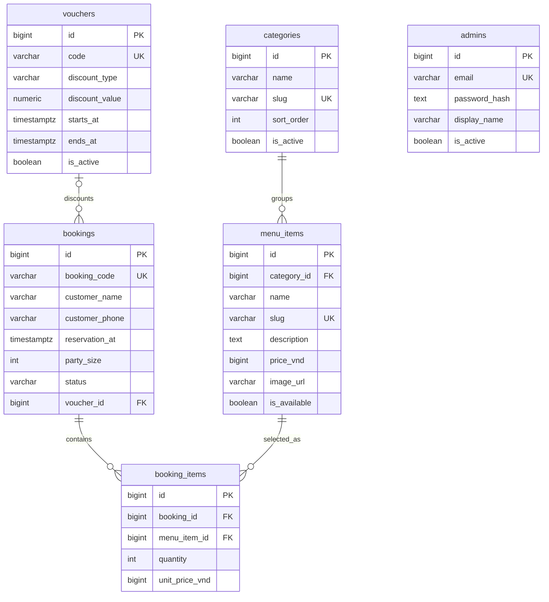

# Sơ đồ dữ liệu

## Quy ước

- Tiền lưu bằng đồng Việt Nam nguyên (`bigint`), không dùng số thực. `booking_items.unit_price_vnd` là giá chụp tại thời điểm đặt để giữ lịch sử khi giá thực đơn đổi.
- `booking_items` là dòng món của đơn đặt bàn, liên kết đơn và món, lưu số lượng. Khi xóa món đã được đặt, khóa ngoại chặn xóa để giữ lịch sử.
- Mã voucher được lưu hoa và không dấu cách ở tầng ứng dụng; một đơn có thể không có voucher. Xóa voucher sẽ đặt `voucher_id` về `NULL`.
- Tài khoản admin chỉ lưu `password_hash`, tuyệt đối không lưu mật khẩu thuần.
- Thời điểm đặt bàn dùng `timestamptz`; ứng dụng nên lưu/trao đổi thời gian theo UTC và hiển thị theo múi giờ nhà hàng.
- Dùng `is_active`/`is_available` để ẩn dữ liệu khỏi giao diện mà không cần xóa lịch sử.

Xem [database/schema.sql](../database/schema.sql) để khởi tạo bảng, ràng buộc và chỉ mục.

## Lưu đặt bàn khi chạy dự án

Máy chủ chạy ngay dùng các bảng `bookings`, `booking_items`, `admins` và `admin_sessions` trong `data/bookings.sqlite3`, được tạo tự động. Đơn lưu mã, tên, số điện thoại, ngày đến, giờ, số người, mã ưu đãi, tổng trước giảm, tiền giảm và các dòng món với giá phía máy chủ. Tài khoản lưu hash PBKDF2; bảng phiên chỉ lưu hash của token phiên. Đây là bản SQLite gọn để dự án có thể chạy không cần cài gói ngoài; `database/schema.sql` giữ lược đồ PostgreSQL làm bản tham chiếu cho triển khai tiếp theo.
